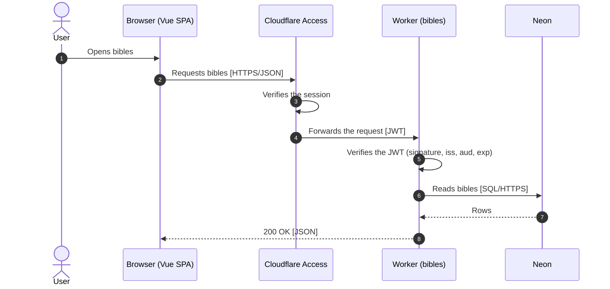

# c4-sequence

Draw the route under the following rules.

## Rules

1. Draw one route per `sequenceDiagram`, under a heading that names the route.
2. Number every step with `autonumber`.
3. Keep every participant at one C4 level: people, containers, and external systems.
4. Name a person by role, such as `User`, never by a personal name.
5. Merge what deploys together into one container, such as a Worker and the static assets it serves.
6. Label a request `->>` with what it does and its technology: `Verb phrase [technology]`.
7. Label a response `-->>` with what comes back: `status or data [format]`.
8. Draw a self-call `X->>X` only for a step that decides whether the route goes on, such as verifying a token or authorizing a user.
9. Leave out what lives below the container level: header and cookie names, function names, libraries, and steps that never stop the route.
10. Write no prose and no `Note` blocks.

## Example

